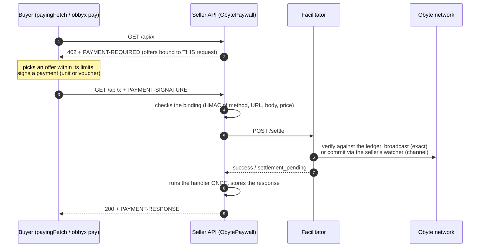
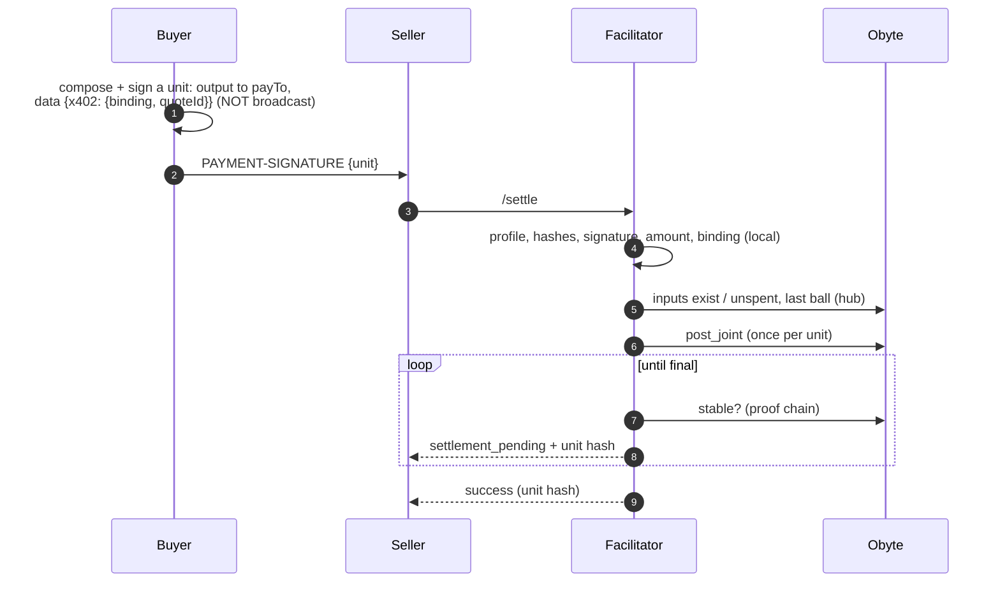
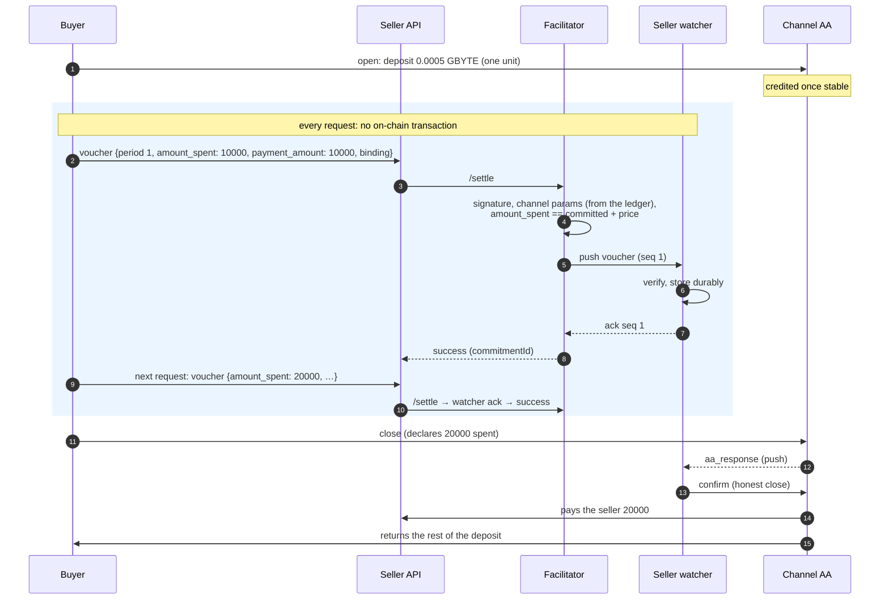

# obbyx

[](https://www.npmjs.com/package/@obbyx/sdk)
[](https://www.npmjs.com/package/@obbyx/x402-obyte)
[](https://www.npmjs.com/package/@obbyx/cli)
[](LICENSE)

**x402 payments on [Obyte](https://obyte.org).** A facilitator, a seller SDK, a
buyer SDK, a CLI and a seller watcher that let any HTTP API charge per request
in GBYTE or Obyte assets using the [x402](https://x402.org) protocol, and let
agents and services pay for them within explicit limits.

- **Non-custodial:** funds go from the buyer directly to the seller; the facilitator never holds money and signs nothing.
- **Two schemes:** `exact` (one on-chain Obyte unit per request) and `batch-settlement` (instant, fee-free per call over AA payment channels).
- **Standard x402:** v2 (and v1 for `exact`), Bazaar discovery, `payment-identifier`, `EXTENSION-RESPONSES`; the official `@x402/fetch` and `@x402/express` work unchanged.
- **One payment, one operation:** every offer is bound to the request; a payment is broadcast once, served once, never charged twice.

> Status: testnet-ready, not yet run on mainnet. Read
> [Security and trust](docs/guide/security.md) before using payment channels.

## Contents

- [How it works](#how-it-works)
- [Install](#install)
- [Quickstart on testnet](#quickstart-on-testnet)
- [Payment channels](#payment-channels)
- [Playground](#playground)
- [Selling an API (SDK)](#selling-an-api-sdk)
- [Paying for APIs (SDK)](#paying-for-apis-sdk)
- [Using with the official x402 packages](#using-with-the-official-x402-packages)
- [CLI](#cli)
- [Running the facilitator](#running-the-facilitator)
- [Configuration](#configuration)
- [Documentation](#documentation)
- [Development](#development)
- [Repository layout](#repository-layout)
- [License](#license)

## How it works

### The x402 handshake



Every offer carries a **binding**: an HMAC of the seller over the request
(method, URL, body), the price and a random quote id. The buyer signs it into
the payment, so a payment can pay for that one operation only. A repeated
request with the same payment returns the stored response; a pending payment
is retried with the same payment, never a new one.

### `exact`: one on-chain payment per request



The facilitator's state per unit: `claimed → broadcasting → accepted →
stable_good` (or `final_bad` on a double spend, `rejected`, `expired`). Every
transition is a compare-and-set, so a unit is broadcast at most once even
under concurrent requests.

### `batch-settlement`: payment channels ("batching")

Instead of one on-chain unit per request, the buyer locks a deposit once in a
**channel** (an Obyte autonomous agent shared by buyer and seller) and pays
each request with a signed **voucher** for the _cumulative_ amount spent so
far. Hundreds of requests are paid off-chain and settled with a single
on-chain close.



Why it is safe:

| Risk                                         | Protection                                                                                      |
| -------------------------------------------- | ----------------------------------------------------------------------------------------------- |
| buyer spends more than deposited             | `amount_spent` ≤ confirmed deposit, checked against the ledger                                  |
| one voucher pays twice / for another request | cumulative rule `amount_spent == committed + price`, one voucher in flight per channel, binding |
| seller loses a paid voucher                  | `/settle` succeeds only after the seller's watcher stored it (durable ack)                      |
| buyer closes declaring less than it signed   | the watcher answers with a **fraud proof** using the best voucher                               |
| watcher offline                              | channel payments are refused (fail-closed); buyers pay with `exact` meanwhile                   |

The channel's dispute window (`--window`) must be longer than the seller's
watcher can be offline. Trust model: [Security and trust](docs/guide/security.md).

### Which scheme

|             | `exact`                                                                                           | `batch-settlement` (channels)          |
| ----------- | ------------------------------------------------------------------------------------------------- | -------------------------------------- |
| Per request | one unit signed by the buyer, broadcast by the facilitator                                        | one signed voucher, nothing on-chain   |
| Speed       | until final: minutes under load, up to ~2 h on a quiet network (instant with `FINALITY=accepted`) | instant (the seller's watcher acks)    |
| Fees        | network fee per request                                                                           | one deposit, one close                 |
| Seller runs | the paywall                                                                                       | the paywall + a **watcher**            |
| Buyer needs | bytes in the wallet                                                                               | an open, funded channel to this seller |

`payingFetch` / `obbyx pay` use a channel when one is open to the seller and
fall back to `exact` otherwise.

### Components

| Component      | Path                                                | Role                                                                                        |
| -------------- | --------------------------------------------------- | ------------------------------------------------------------------------------------------- |
| Facilitator    | `apps/facilitator`                                  | x402 `/verify`, `/settle`, `/supported`, Bazaar discovery; verifies and broadcasts payments |
| Seller SDK     | `packages/sdk` (`ObytePaywall`, `ObyteExactServer`) | 402 offers bound to the request; one payment = one operation                                |
| Buyer SDK      | `packages/sdk` (`payingFetch`, `SpendingBudget`)    | pays within per-call and total limits; never pays twice                                     |
| Mechanisms     | `packages/x402-obyte`                               | the x402 scheme implementations for Obyte                                                   |
| Seller watcher | `apps/watcher`                                      | stores vouchers, closes channels, answers disputes                                          |
| CLI            | `packages/cli` (`obbyx`)                            | wallet, faucet, pay, channels, diagnostics, logs                                            |
| Demo           | `apps/demo`                                         | a paid demo API and a playground page                                                       |

## Install

Requires **Node.js 24**.

### Packages (npm)

| Package                                                                | Install                             | For                                                                     |
| ---------------------------------------------------------------------- | ----------------------------------- | ----------------------------------------------------------------------- |
| [`@obbyx/cli`](https://www.npmjs.com/package/@obbyx/cli)               | `npm i -g @obbyx/cli`               | the `obbyx` command: wallet, faucet, pay, channels                      |
| [`@obbyx/sdk`](https://www.npmjs.com/package/@obbyx/sdk)               | `npm i @obbyx/sdk @x402/core obyte` | sellers (`ObytePaywall`, `ObyteExactServer`) and buyers (`payingFetch`) |
| [`@obbyx/x402-obyte`](https://www.npmjs.com/package/@obbyx/x402-obyte) | `npm i @obbyx/x402-obyte obyte`     | the Obyte mechanisms for the official `@x402/*` packages                |
| [`@obbyx/obyte`](https://www.npmjs.com/package/@obbyx/obyte)           | installed with the above            | networks, amounts, validation, wallet, logger                           |

```sh
npm i -g @obbyx/cli
obbyx --help
```

### Services (from source)

The facilitator, the seller watcher and the demo are services, not npm
packages: run them from the repository (or with Docker, see
[Running the facilitator](#running-the-facilitator)).

```sh
git clone https://github.com/Taump/obbyx.git
cd obbyx
pnpm install        # pnpm 12: `npm i -g pnpm@12.16.1`, or prefix with `npx pnpm@12.16.1`
pnpm build
```

## Quickstart on testnet

Everything runs locally on Obyte **testnet**; no real money is involved.

### 1. Wallets

```sh
obbyx init                                   # buyer: ~/.obbyx/wallet-testnet.json (mode 0600)
OBBYX_HOME=~/.obbyx-seller obbyx init        # seller: a second wallet
OBBYX_HOME=~/.obbyx-seller obbyx address     # → the seller address (PAY_TO below)
```

### 2. Testnet bytes for the buyer

```sh
obbyx faucet       # asks the testnet Faucet Bot (once per 24 h per device)
obbyx balance      # spendable once stable (minutes, up to ~2 h on a quiet network)
```

### 3. Facilitator

```sh
cd apps/facilitator
pnpm db:migrate                          # creates ./data/facilitator.db (again after upgrades)
FINALITY=accepted LOG_PRETTY=1 node dist/main.js
# → http://127.0.0.1:4021   GET /supported, /health, /openapi.json
cd ../..
```

`FINALITY=accepted` answers as soon as the network accepted the unit, which is
convenient for a demo. The default `stable` waits for finality (see
[Concepts](docs/guide/concepts.md#finality)).

### 4. Demo seller API

```sh
cd apps/demo
PAY_TO=<seller address> SELLER_SECRET=$(openssl rand -hex 32) LOG_PRETTY=1 node dist/server.js
# → http://127.0.0.1:3402   GET /api/fortune (10000 bytes), POST /api/echo (20000 bytes)
cd ../..
```

### 5. Pay for a request

```sh
obbyx pay http://127.0.0.1:3402/api/fortune --max 0.00001
```

```text
HTTP 200
Paid: 0.00001 GBYTE, unit 66kESPftZcexQxRONLOh0e06JfHIG8O2Ry3renhWyJo=
  https://testnetexplorer.obyte.org/66kESPftZcexQxRONLOh0e06JfHIG8O2Ry3renhWyJo%3D
{"fortune":"Stability comes to those who wait for the main chain."}
```

What happened: the API answered `402` with an offer bound to this request; the
CLI signed (not broadcast) a unit paying the seller with the offer's binding in
a data message; the seller asked the facilitator to settle; the facilitator
checked the unit, broadcast it and confirmed it; the API ran the handler once
and returned the result with a `PAYMENT-RESPONSE` header.

If the payment is not final within `--wait` seconds (default 600), the CLI
prints `--payment <header>`: repeat the same command with it later; it never
pays twice.

## Payment channels

Instant, fee-free per call. The seller must run a **watcher** (it stores the
vouchers that are the seller's money and closes channels).

```sh
# seller: watcher (keep it running and funded with some bytes)
cd apps/watcher && pnpm db:migrate
OBBYX_HOME=~/.obbyx-seller node dist/main.js
cd ../..

# seller: offer channels in the demo
PAY_TO=<seller address> SELLER_SECRET=… BATCH_MIN_CHANNEL_TIMEOUT=3600 node apps/demo/dist/server.js

# buyer
obbyx channel open <seller address> --deposit 0.0005 --window 3600
obbyx channel status <aa>        # usable once the deposit is credited (after stability)
obbyx pay http://127.0.0.1:3402/api/fortune --max 0.00001   # uses the channel automatically
obbyx channel close <aa>         # the seller's watcher confirms; the rest returns to you
```

A channel payment succeeds only after the seller's watcher has durably stored
the voucher. If the watcher is offline, channel payments are refused and the
buyer pays with `exact` instead. Details: [Payment channels](docs/guide/channels.md).

## Playground

The demo includes a page that runs a real testnet payment and shows each step
(request → 402 offer → signed payment → settlement → response):

```sh
PAY_TO=<seller address> SELLER_SECRET=… PLAYGROUND_BUYER_HOME=~/.obbyx node apps/demo/dist/server.js
open http://127.0.0.1:3402/playground
```

Enabled only on testnet, on a loopback address, with an explicit buyer wallet.

## Selling an API (SDK)

```ts
import express from 'express';
import { HTTPFacilitatorClient } from '@x402/core/http';
import { createLogger } from '@obbyx/obyte/logger';
import { ConsumedProofsStore, ObytePaywall } from '@obbyx/sdk';

const paywall = new ObytePaywall({
  facilitator: new HTTPFacilitatorClient({ url: 'http://127.0.0.1:4021' }),
  network: 'obyte:testnet',
  payTo: 'YOUR_OBYTE_ADDRESS',
  sellerId: 'my-api',
  secret: process.env.SELLER_SECRET!, // ≥ 32 chars: HMAC key for request bindings
  store: new ConsumedProofsStore('./data/proofs.db'),
  logger: createLogger(),
  // batch: { minChannelTimeoutSeconds: 3600 },   // accept channels (run your watcher)
  // paymentIdentifier: { required: false },      // x402 payment-identifier
});

const app = express();
app.use(express.json());
app.post(
  '/api/answer',
  paywall.paid({ price: { amount: '20000' } }, async (req) => ({ body: { answer: 42 } })),
);
app.listen(3402);
```

The handler returns its response instead of writing to `res`, so a repeated
request with the same payment gets the stored response. More:
[SDK guide](docs/guide/sdk.md).

## Paying for APIs (SDK)

```ts
import obyte from 'obyte';
import { OBYTE_NETWORKS } from '@obbyx/obyte';
import { createLogger } from '@obbyx/obyte/logger';
import { loadWallet } from '@obbyx/obyte/wallet';
import { CoinReservations, ExactObyteClient, ReservingComposer } from '@obbyx/x402-obyte';
import { SpendingBudget, payingFetch } from '@obbyx/sdk';

const network = OBYTE_NETWORKS.testnet;
const wallet = loadWallet(network); // ~/.obbyx/wallet-testnet.json
const client = new obyte.Client(network.defaultHubUrl, { testnet: true, reconnect: true });
const logger = createLogger();
const composer = new ReservingComposer({
  client,
  network: network.caip2,
  address: wallet.address,
  reservations: new CoinReservations('./coins.db'),
  logger,
});
const exact = new ExactObyteClient({
  client,
  network: network.caip2,
  privateKey: wallet.privateKey,
  logger,
  composer,
  maxFee: 10_000n,
});

const { response, payment } = await payingFetch(
  'http://127.0.0.1:3402/api/fortune',
  { method: 'GET' },
  {
    mechanisms: { exact },
    network: network.caip2,
    maxAmount: new Map([['base', 50_000n]]), // per call
    budget: new SpendingBudget({ total: new Map([['base', 1_000_000n]]) }), // overall
    logger,
  },
);
```

Guarantees: concurrent payments never pick the same coins; a budget is never
overshot; an unknown outcome stays counted; a pending payment is retried with
the same payment, never a new one.

## Using with the official x402 packages

obbyx is a standard x402 facilitator plus Obyte mechanisms for the official
`@x402/*` packages, so any x402 stack can use Obyte.

**Buyer** — `@x402/fetch` with the Obyte client mechanism:

```ts
import { wrapFetchWithPayment, x402Client } from '@x402/fetch';
import { ExactObyteClient } from '@obbyx/x402-obyte';

const paidFetch = wrapFetchWithPayment(
  fetch,
  new x402Client()
    // GBYTE is not a default (USD) asset: allow it explicitly, with a cap
    .setSpendControls({
      allowedAssets: [{ network: 'obyte:testnet', asset: 'base', maxAmountPerPayment: '50000' }],
    })
    .register(
      'obyte:testnet',
      new ExactObyteClient({ client, network: 'obyte:testnet', privateKey, logger }),
    ),
);
const res = await paidFetch('https://api.example/paid');
```

**Seller** — `@x402/express` (or any official server) with the Obyte server
mechanism, pointed at an obbyx facilitator:

```ts
import { paymentMiddleware, x402ResourceServer } from '@x402/express';
import { HTTPFacilitatorClient } from '@x402/core/http';
import { ConsumedProofsStore, ObyteExactServer } from '@obbyx/sdk';

const server = new x402ResourceServer(
  new HTTPFacilitatorClient({ url: 'http://127.0.0.1:4021' }),
).register(
  'obyte:testnet',
  new ObyteExactServer({
    sellerId: 'api',
    secret: SELLER_SECRET,
    proofs: new ConsumedProofsStore('proofs.db'),
    logger,
  }),
);
app.use(
  paymentMiddleware(
    {
      'GET /api/x': {
        accepts: {
          scheme: 'exact',
          network: 'obyte:testnet',
          payTo: SELLER_ADDRESS,
          price: '20000 bytes',
        },
      },
    },
    server,
  ),
);
```

**Facilitator** — run `apps/facilitator`; any x402 resource server talks to it
over the standard HTTP API (`/verify`, `/settle`, `/supported`;
[OpenAPI](docs/reference/facilitator-api.md)).

| Feature                                | Official packages             | obbyx SDK (`ObytePaywall`, `payingFetch`) |
| -------------------------------------- | ----------------------------- | ----------------------------------------- |
| `exact`                                | ✅                            | ✅                                        |
| `batch-settlement` (channels)          | not yet (no server mechanism) | ✅                                        |
| stored response for a repeated request | —                             | ✅                                        |
| `payment-identifier`, spending budgets | —                             | ✅                                        |
| x402 v1                                | ✅ client + facilitator       | —                                         |

Details: [x402 compatibility](docs/guide/x402-compatibility.md).

## CLI

| Command                                                                                                 | Does                                         |
| ------------------------------------------------------------------------------------------------------- | -------------------------------------------- |
| `obbyx init [--network testnet\|livenet] [--force]`                                                     | create a local wallet                        |
| `obbyx address` / `obbyx balance`                                                                       | show the address / balance                   |
| `obbyx faucet`                                                                                          | get testnet bytes                            |
| `obbyx pay <url> --max <GBYTE> [--method M] [--data JSON] [--header 'K: V'] [--wait SEC] [--payment H]` | call a paid API                              |
| `obbyx channel open\|list\|status\|deposit\|close\|confirm`                                             | payment channels                             |
| `obbyx doctor [--facilitator URL]`                                                                      | check wallet, hub, balance, pending payments |
| `obbyx logs <files…> --binding B`                                                                       | follow one payment through JSON logs         |
| `obbyx decode <base64>`                                                                                 | decode an x402 header                        |

Every command has `--help`; full reference: [CLI](docs/reference/cli.md).
Exit codes: 0 ok, 1 error, 2 refused, 3 pending (retry later).

## Running the facilitator

```sh
pnpm --filter @obbyx/facilitator db:migrate
FACILITATOR_API_KEYS=<key> node apps/facilitator/dist/main.js
```

Or with Docker Compose:

```sh
docker compose up -d facilitator                               # http://127.0.0.1:4021
OBBYX_SELLER_HOME=~/.obbyx-seller docker compose --profile watcher up -d
```

Before exposing it beyond localhost: set `FACILITATOR_API_KEYS`, put it behind
TLS, keep `PACKAGE_KEY_FILE` (the key that encrypts stored channel vouchers)
out of database copies. Runbooks: [Operations](docs/guide/operations.md).

## Configuration

All services use environment variables, validated at startup. Every variable
with its default: [Configuration reference](docs/reference/configuration.md).
The most important ones:

| Variable                    | Service      | Default         | Meaning                                                         |
| --------------------------- | ------------ | --------------- | --------------------------------------------------------------- |
| `NETWORKS`                  | facilitator  | `obyte:testnet` | networks to serve                                               |
| `FINALITY`                  | facilitator  | `stable`        | `stable` or `accepted`                                          |
| `FACILITATOR_API_KEYS`      | facilitator  | —               | keys for `/verify` and `/settle` (empty = open, localhost only) |
| `MAX_LAST_BALL_AGE_SECONDS` | facilitator  | `10800`         | tolerated lag of the network's stable point                     |
| `PAY_TO`, `SELLER_SECRET`   | seller       | —               | where money goes; HMAC key for bindings                         |
| `OBBYX_HOME`                | CLI, watcher | `~/.obbyx`      | wallet directory                                                |
| `LOG_LEVEL`, `LOG_PRETTY`   | all          | `info` / —      | logging                                                         |

## Documentation

The site is built with VitePress: `pnpm docs:dev` (or `pnpm docs:build`).

| Topic                                     | Page                                                                                                       |
| ----------------------------------------- | ---------------------------------------------------------------------------------------------------------- |
| Concepts, lifecycle, finality             | [docs/guide/concepts.md](docs/guide/concepts.md)                                                           |
| Architecture and patterns                 | [docs/guide/architecture.md](docs/guide/architecture.md)                                                   |
| Security and trust                        | [docs/guide/security.md](docs/guide/security.md)                                                           |
| Operations (runbooks)                     | [docs/guide/operations.md](docs/guide/operations.md)                                                       |
| Scheme specs                              | [exact](docs/specs/scheme_exact_obyte.md), [batch-settlement](docs/specs/scheme_batch_settlement_obyte.md) |
| HTTP API, error codes, CLI, configuration | [docs/reference/](docs/reference/)                                                                         |
| Design decisions                          | [docs/adr/](docs/adr/)                                                                                     |

## Development

```sh
pnpm install
pnpm typecheck && pnpm lint && pnpm test     # what CI runs (plus format:check, build, docs)
pnpm test:watch
pnpm docs:gen                                # regenerate docs/reference after changing schemas, CLI or errors
OBBYX_LIVE_TESTNET=1 pnpm test               # also run the live testnet tests
```

Apps run from source with `pnpm --filter @obbyx/<app> dev`. Rules for
contributors (BigInt amounts, fail-closed outcomes, no secrets in logs, zod at
the boundary): [CONTRIBUTING.md](CONTRIBUTING.md). Vulnerabilities:
[SECURITY.md](SECURITY.md).

## Repository layout

```text
packages/obyte        Obyte primitives: networks, amounts, unit and voucher validation, wallet, logger
packages/x402-obyte   x402 mechanisms for Obyte (exact, batch-settlement), hub access, coin reservation
packages/sdk          seller paywall and official-server adapter; buyer payingFetch and budgets
packages/cli          the obbyx command line
packages/docs-gen     generator of docs/reference from the code
apps/facilitator      the x402 facilitator (Fastify, Prisma/SQLite)
apps/watcher          the seller watcher for payment channels
apps/demo             demo paid API and playground
docs/                 guides, reference, specs, ADRs (VitePress)
```

## License

MIT.
